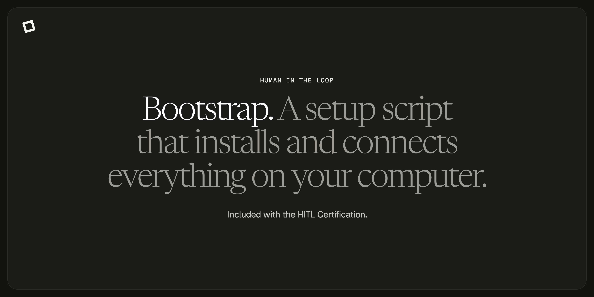

# Bootstrap

A setup script that installs and connects everything on your computer.

> **This repository is a preview.** The working code comes with The HITL Certification. Holders get it in a private repository and set it up on their own accounts.

## What it is

This is the script you run first. On your own computer and accounts, it creates your Trello board, connects Slack, sets up the configuration your operator needs, and checks that everything works.

## What's in it

- Creates your Trello board and lists.
- Connects Slack.
- Writes your operator's configuration.
- Runs a check at the end so you know it all works.

## How to get it

It comes with The HITL Certification (the Human-in-the-Loop Certification, to the Pixelworkers HITL Standard). You set everything up on your own accounts, use it on real work, and then walk us through that work live.

It's for designers, developers and marketers. You need to be comfortable with GitHub and a terminal.

Early access opens December 1. [Sign up at pixelworkers.org/certifications](https://pixelworkers.org/certifications)

## The standard

- **Closed Loop.** Your data, your code, your brand never leave secure, closed-loop infrastructure, and they never train a public model.
- **The Accountable Team.** Every project has a named human architect and a named AI operator, both on the record. Nothing ships unvalidated and nothing ships unsigned.
- **The Partnership.** Architect and agent solving the same problem together, each doing what it's actually best at.

## The other repositories

- [operator](https://github.com/pixelworkers/operator): Your named AI partner. You work the same problem together.
- [hub](https://github.com/pixelworkers/hub): Securely connects your operator to any tool you use.
- [kb-template](https://github.com/pixelworkers/kb-template): A folder structure for client notes, brand rules and a log of changes.

---

[pixelworkers.org](https://pixelworkers.org)
